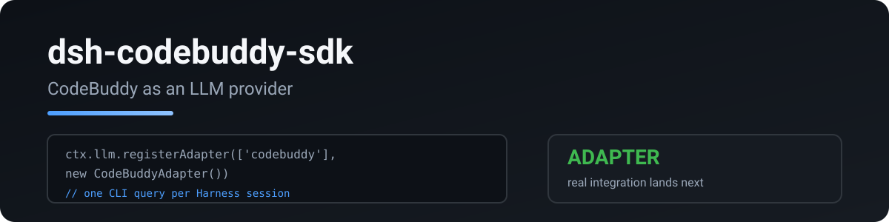

<p align="center"></p>

# dsh-codebuddy-sdk

Use your CodeBuddy DeepSeek allowance from DSH through the official CodeBuddy Server. DSH owns prompts, history, compaction and tool execution. The provider returns streamed model output and per-generation token usage.

English · [中文](README.zh.md)

Based on [RetiredPhysicist/dsh-plugins](https://github.com/RetiredPhysicist/dsh-plugins/tree/main/packages/dsh-codebuddy-sdk), originally ported from [pi-codebuddy-sdk](https://github.com/RetiredPhysicist/pi-plugins/tree/main/packages/pi-codebuddy-sdk). This checkout contains an unpublished local migration.

## Setup

Requires Node >=24, DSH 0.2.1-rc.3 and an existing official CodeBuddy CLI login. Agent SDK 0.3.287 and CodeBuddy Code 2.172.1 are pinned. The auto-updating user launcher is not used.

```sh
npm ci --ignore-scripts
npm run build
dsh plugin --profile web add /data/ida/ai/dsh-codebuddy-sdk
```

The final command changes that profile. Development acceptance uses temporary profiles; your everyday profile is not installed or changed.

Select `codebuddy/deepseek-v4.1-flash` in DSH. Enabling or disabling this plugin does not change your default model automatically. Select your configured official DeepSeek route when switching back.

```yaml
- id: codebuddy
  name: dsh-codebuddy-sdk
  config:
    model: deepseek-v4.1-flash
    maxTokens: 8192
```

`provider` overrides the route, `cwd` sets the runtime directory, and `contextWindow` overrides DSH budgeting metadata. Per-request `maxTokens` takes precedence. Remove the legacy `pathToCodebuddyCode` option; Server uses its pinned dependency.

## Behavior

Each generation receives DSH's complete current native role history. Compaction, pruning, edits and process restart do not require importing a persistent SDK session. Tool calls and results retain their IDs, including parallel identical calls. Invalid or incomplete tool relationships fail before provider I/O.

DSH executes every business tool. The SDK receives declarations through public MCP APIs, is denied tool execution, and is limited to one outbound model request by the official HTTP host policy. Each request runs in a separate child process. Official SDK authentication supplies the current login directly in worker memory; the plugin does not decode or persist credentials.

DSH system prompts override defaults. Controllable CodeBuddy project rules, memory and background work are disabled. DSH owns compaction; the host policy blocks additional SDK recovery model requests. Summary requests are independent calls using DSH's history and instructions.

Token usage separates uncached input, cache reads, cache writes and output. Unknown usage remains unknown. Token counts are not currency charges.

## Failure handling

Empty replies fail explicitly. Refusal text is visible and marked as an error. Complete tool batches are validated before DSH receives executable calls; truncated or malformed calls are rejected. Context overflow, authentication, quota and rate-limit facts survive worker IPC when exposed by the official runtime.

Each generation allows one outbound model request. Some network errors are hidden behind SDK recovery before a public error appears; these return `CODEBUDDY_RETRY_BLOCKED` and can be retried manually. Missing retry delays, request identifiers and usage stay unknown. Response metadata includes requested/reported models, finish reason and elapsed time.

A completed model response has a 5-second SDK cleanup deadline and a further 1-second process-group confirmation window. Verified output remains usable after confirmed forced cleanup. Unconfirmed cleanup fails with `CODEBUDDY_CLEANUP_TIMEOUT`; missing completion acknowledgment fails with `CODEBUDDY_FINALIZATION_TIMEOUT`. Cancellation remains cancellation. Cleanup diagnostics are included in response metadata.

## Boundaries and verification

Text messages and text tool results are supported. Unsupported content and explicit unverified `temperature`/`stop` settings are rejected. CodeBuddy retains its user-query wrapper, merges adjacent user messages, prefixes MCP tools, and supplies some parameter defaults. It can change top-level schema `additionalProperties`. Fresh runtime startup adds latency. Model quality and deployment identity are not guaranteed to match the official DeepSeek API.

```sh
npm run typecheck
npm run test:ci
npm run test:integration
```

Integration uses actual DSH and official runtimes with a local mock endpoint in a loopback-only network namespace. Linux, `unshare`, `iproute2` and namespace privileges are required. No account allowance is spent.

Live acceptance is opt-in: `node scripts/test-daily-live.mjs --run`, after the complete offline suite passes. The separately authorized budget is at most 8 new calls including failures and summaries; ordinary output is capped at 512 tokens, summaries at 2048, and DSH request content at 64 KiB. Existing ledgers are preserved; the script refuses automatic reruns.

Optional browser acceptance uses `node scripts/test-web.mjs` and `node scripts/test-web-browser.mjs`: actual DSH Web and Chromium, dummy credentials and a local model fixture. Configure local Playwright and Chrome paths with `DSH_PLAYWRIGHT_MODULE` and `DSH_CHROME_PATH`. See [daily reliability](docs/daily-reliability.md) for acceptance and rollback instructions.

Six-hour reliability passed with 981 local generations, five scheduled restarts, and three browser checkpoints. Live compaction and recovery passed. Coding completion and equivalence with the official API remain unverified; all eight paired outputs hit the approved output cap. See [long reliability verification](docs/long-reliability.md).

MIT
