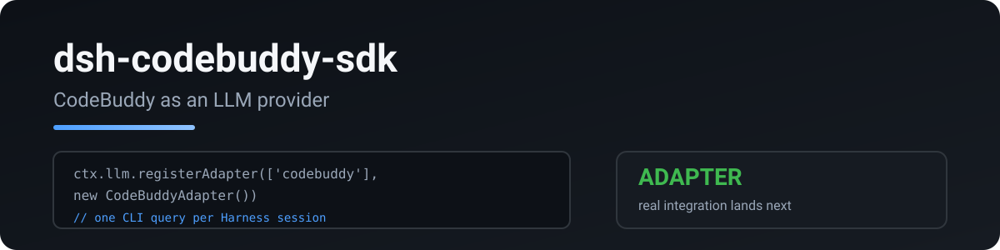

<p align="center"></p>

# dsh-codebuddy-sdk

Use your CodeBuddy DeepSeek allowance from DSH through the official CodeBuddy Server. DSH owns prompts, history, compaction and tool execution. The provider returns streamed model output and per-generation token usage.

English · [中文](README.zh.md)

Based on [RetiredPhysicist/dsh-plugins](https://github.com/RetiredPhysicist/dsh-plugins/tree/main/packages/dsh-codebuddy-sdk), originally ported from [pi-codebuddy-sdk](https://github.com/RetiredPhysicist/pi-plugins/tree/main/packages/pi-codebuddy-sdk). This checkout contains an unpublished local migration.

## Setup

Requires Node >=24, DSH 0.2.1-rc.3 and an existing official CodeBuddy CLI login. Agent SDK 0.3.287 and CodeBuddy Code 2.172.1 are pinned. The auto-updating user launcher is not used.

```sh
npm ci --ignore-scripts
npm run build
dsh plugin --profile web add /data/ida/ai/dsh-codebuddy-sdk
```

The final command changes the selected profile. Verify the loaded version through that profile’s normal loading process.

Select `codebuddy/deepseek-v4.1-flash` in DSH. Enabling or disabling this plugin does not change your default model automatically. Select your configured official DeepSeek route when switching back.

For Hy4, select the catalog entry `codebuddy/hy4std` with `high` reasoning. The plugin accepts the reported `hy4-ioa` alias and preserves the original response model ID; preview releases and other models are still checked separately.

```yaml
- id: codebuddy
  name: dsh-codebuddy-sdk
  config:
    model: deepseek-v4.1-flash
    searchModel: deepseek-v4.1-flash
    maxTokens: 8192
    toolPolicy:
      deny:
        - 'mcp__tapd__*'
        - 'mcp__gongfeng__*'
```

`provider` overrides the route, `cwd` sets the runtime directory, and `contextWindow` overrides DSH budgeting metadata. Per-request `maxTokens` takes precedence. Remove the legacy `pathToCodebuddyCode` option; Server uses its pinned dependency.

`toolPolicy` filters model-visible tools: omitted `allow` means every tool, `deny` wins after `allow`, and `*` is the only wildcard. The example keeps core tools and OpenViking while excluding TAPD/Gongfeng; use `deny: ['mcp__*']` for a core-only coding surface. It changes only what the model sees, not DSH execution permissions; filtered tools never reach the model-visible list.

`retryPolicy` is executed by DSH's `llm-retry` on the agent's failed-step extension point, with the same form official providers use: `mode: normal` (default) retries `EMPTY_RESPONSE`, `RATE_LIMIT`, `SERVER`, `TIMEOUT`, `TRANSPORT` and `NETWORK` with `maxRetries` 5; `mode: always` retries every failed model request. A model stream silent for 3 minutes now fails as a timeout/network error and is retried automatically instead of waiting for the upstream 10-minute idle cut. Model-output faults such as a degraded response or corrupt tool arguments are outside the default set; opt in per route with explicit `retryableCodes` or `always`.

## Behavior

Each generation receives DSH's complete current native role history. Compaction, pruning, edits and process restart do not require importing a persistent SDK session. Stable bidirectional names distinguish hyphenated tools from underscored tools, with original DSH names included in aliased tool descriptions. Tool calls and results retain their IDs, including parallel identical calls. Invalid or incomplete tool relationships fail before provider I/O. A call truncated by the output limit is not delivered; a call whose arguments are corrupt is delivered verbatim so DSH's own argument validation reports the error for that call alone and the rest of the batch still runs.

DSH executes every tool declared for the conversation. Ordinary model workers receive declarations through public MCP APIs, deny SDK tool execution, and allow one outbound model request through the official HTTP host policy. Native web search runs in its own worker with only WebSearch enabled. Each request runs in a separate child process. Official SDK authentication supplies the current login directly in worker memory; the plugin does not decode or persist credentials.

DSH system prompts override defaults. Controllable CodeBuddy project rules, memory and background work are disabled. DSH owns compaction; the host policy blocks additional SDK recovery model requests. Summary requests are independent calls using DSH's history and instructions.

Ordinary generations preserve historical tool results in full. The SDK tool-result spill threshold is computed from the current input byte size, so replay does not replace results with a 2KB preview containing a temporary SDK session path. DSH owns history retention.

Token usage separates uncached input, cache reads, cache writes and output. Unknown usage remains unknown. Token counts are not currency charges. The gateway zero-fills Anthropic cache names and reports the real hit under `prompt_tokens_details.cached_tokens` / `prompt_cache_hit_tokens`; the adapter reads the first positive value across the supported names. `prompt_cache_miss_tokens` is uncached input, not an extra cache-write bucket.

## Web search and fetch

When DSH's web service is mounted, the plugin registers the `codebuddy` search provider. It runs the official SDK's native `WebSearch` tool using the existing CodeBuddy sign-in, with no DeepSeek API key. Only structured tool results become sources; model-written links are never substituted for search results.

```yaml
- id: web
  config:
    searchProvider: codebuddy
    fetchProvider: http
```

The built-in `http` fetch provider retrieves public pages anonymously. Search defaults to `hy4-preview-ioa`; `searchModel` selects an exact auxiliary model without changing the conversation model. Explicit `deepseek-v4.1-flash` searches use high effort. Each search performs one model call and one native search, subject to that model's allowance and service availability. Auxiliary usage is written to structured `codebuddy/search-usage` runtime logs with the initiating session ID when present, separately from conversation-step usage. Cancellation is supported and the operation times out after 90 seconds. Missing native tool results fail explicitly.

The `deepseek-search-api`, `deepseek-fetch-api`, and `deepseek-official` backends use independent DeepSeek credentials and do not inherit CodeBuddy authentication.

## Failure handling

Empty replies fail explicitly. Refusal text is visible and marked as an error. Complete tool batches are validated before DSH receives executable calls; truncated or malformed calls are rejected. Context overflow, authentication, quota and rate-limit facts survive worker IPC when exposed by the official runtime.

Each generation allows one outbound model request. Some network errors are hidden behind SDK recovery before a public error appears; these return `CODEBUDDY_RETRY_BLOCKED` and can be retried manually. Missing retry delays, request identifiers and usage stay unknown. Response metadata includes requested/reported models, finish reason and elapsed time.

A completed model response has a 5-second SDK cleanup deadline and a further 1-second process-group confirmation window. Verified output remains usable after confirmed forced cleanup. Unconfirmed cleanup fails with `CODEBUDDY_CLEANUP_TIMEOUT`; missing completion acknowledgment fails with `CODEBUDDY_FINALIZATION_TIMEOUT`. Cancellation remains cancellation. Cleanup diagnostics are included in response metadata.

## Boundaries and verification

Text, user images, and image-bearing tool results are supported. Image bytes come from the DSH attachment service; model vision capabilities come from the CodeBuddy catalog. Offloaded images retain DSH text placeholders. CodeBuddy DeepSeek v4.1 Flash high has passed current-image, historical-image and refresh/resume acceptance; other models require their own checks. Unsupported content and explicit unverified `temperature`/`stop` settings are rejected. CodeBuddy retains its user-query wrapper, merges adjacent user messages, prefixes MCP tools, and supplies some parameter defaults. It can change top-level schema `additionalProperties`. Fresh runtime startup adds latency. Model quality and deployment identity are not guaranteed to match the official DeepSeek API.

```sh
npm run typecheck
npm run test:ci
npm run test:integration
```

Integration uses actual DSH and official runtimes with a local mock endpoint in a loopback-only network namespace. Linux, `unshare`, `iproute2` and namespace privileges are required. No account allowance is spent.

Live acceptance is opt-in: `node scripts/test-daily-live.mjs --run`, after the complete offline suite passes. The separately authorized budget is at most 8 new calls including failures and summaries; ordinary output is capped at 512 tokens, summaries at 2048, and DSH request content at 64 KiB. Existing ledgers are preserved; the script refuses automatic reruns.

Optional browser acceptance uses `node scripts/test-web.mjs` and `node scripts/test-web-browser.mjs`: actual DSH Web and Chromium, dummy credentials and a local model fixture. Configure local Playwright and Chrome paths with `DSH_PLAYWRIGHT_MODULE` and `DSH_CHROME_PATH`. See [daily reliability](docs/daily-reliability.md) for acceptance and rollback instructions.

Six-hour reliability passed with 981 local generations, five scheduled restarts, and three browser checkpoints. Live compaction and recovery passed. Coding completion and equivalence with the official API remain unverified; all eight paired outputs hit the approved output cap. See [long reliability verification](docs/long-reliability.md).

MIT
