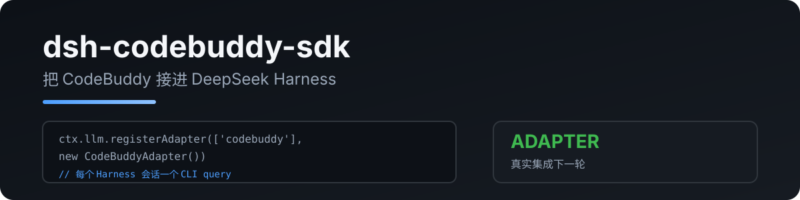

<p align="center"></p>

# dsh-codebuddy-sdk

在 DSH 中使用 CodeBuddy 账号的 DeepSeek 额度。DSH 管理提示词、聊天历史、压缩和工具执行；插件通过腾讯官方 Server 接口执行模型请求并返回流和 token 数据。

[English](README.md) · 中文

基于 [RetiredPhysicist/dsh-plugins](https://github.com/RetiredPhysicist/dsh-plugins/tree/main/packages/dsh-codebuddy-sdk) 重构，原项目移植自 [pi-codebuddy-sdk](https://github.com/RetiredPhysicist/pi-plugins/tree/main/packages/pi-codebuddy-sdk)。当前是尚未发布的本地改造版本。

## 使用

需要 Node >=24、DSH 0.2.1-rc.3 和已登录的 CodeBuddy 官方 CLI。锁定官方 Agent SDK 0.3.287 / CodeBuddy Code 2.172.1，使用包内运行时，不调用会自动更新的用户 launcher。

```sh
npm ci --ignore-scripts
npm run build
dsh plugin --profile web add /data/ida/ai/dsh-codebuddy-sdk
```

安装命令会修改指定 profile。选择目标 profile 后，通过该 profile 的正常加载流程验证实际版本。

在 DSH 中选择 `codebuddy/deepseek-v4.1-flash`。插件启停不会自动改变默认模型；关闭后需要在 DSH 选择已经配置好的官方 DeepSeek 路由。

Hy4 使用账号目录中的 `codebuddy/hy4std`，推理档位为 `high`。插件识别实际响应的 `hy4-ioa` 名称，并保留原始返回模型 ID；预览版与其他模型仍分别校验。

```yaml
- id: codebuddy
  name: dsh-codebuddy-sdk
  config:
    model: deepseek-v4.1-flash
    searchModel: deepseek-v4.1-flash
    maxTokens: 8192
    toolPolicy:
      deny:
        - 'mcp__tapd__*'
        - 'mcp__gongfeng__*'
```

`provider` 指定路由名；`cwd` 指定运行目录；`contextWindow` 覆盖 DSH 的上下文预算；每次请求的 `maxTokens` 优先于插件配置。旧 `pathToCodebuddyCode` 配置需要删除，Server 使用锁定依赖。

`toolPolicy` 过滤模型可见工具：`allow` 省略即全部，`deny` 在 `allow` 之后生效，`*` 是唯一通配符。上例保留核心工具和 OpenViking，排除 TAPD/工蜂；需要纯编码面时用 `deny: ['mcp__*']`。它只改变模型看到的工具，不改变 DSH 的执行权限；被过滤工具不会进入模型可见列表。

`retryPolicy` 交给 DSH 的 `llm-retry` 执行，与官方 provider 同形：`mode: normal`（默认）只重试 `EMPTY_RESPONSE`、`RATE_LIMIT`、`SERVER`、`TIMEOUT`、`TRANSPORT`，`maxRetries` 默认 5；`mode: always` 对每次模型请求失败都重试。响应过短、工具参数损坏这类模型输出问题不在默认集合里，需要时显式加进 `retryableCodes` 或改用 `always`。

## 会话和工具

- 每次提交 DSH 当前完整历史，用户、助手和工具结果各自保留角色与调用 ID。
- 普通对话的历史工具结果完整传给模型；SDK 的工具结果落盘阈值按本次输入字节数计算，避免历史被替换为含临时会话路径的 2KB 预览。内容保留策略由 DSH 管理。
- DSH 压缩、裁剪或编辑历史后，下一次使用修改后的历史；恢复已保存的 DSH 会话不需要旧 SDK 会话文件。
- 摘要生成是独立模型请求，沿用 DSH 的提示词和所选 CodeBuddy 路由。
- 会话工具 Schema 通过公开 MCP 接口传递，会话工具仅由 DSH 执行。并行同名同参数调用以各自 ID 关联结果。
- 普通对话的官方运行时在独立子进程运行；SDK 自行执行会话工具会被拒绝，追加模型请求在公开 HTTP 宿主策略处被阻止。网页搜索使用独立 worker 执行原生搜索工具。
- 账号认证通过官方 SDK 公开认证接口沿用登录态，凭据仅在 worker 内存中传递，不保存到插件文件。
- DSH 系统提示词覆盖默认提示词，关闭可控的 CodeBuddy 规则、自动记忆和后台任务；SDK 额外压缩恢复的模型请求由宿主策略阻止。

工具名称采用稳定的双向映射，含连字符的名称与下划线名称可同时区分，原始 DSH 名称保留在工具描述中。

历史转换接受文本消息、用户图片和工具截图；图片通过 DSH 附件服务读取，模型图片能力来自 CodeBuddy 账号目录。已卸载图片使用 DSH 的文字占位。CodeBuddy DeepSeek v4.1 Flash high 已通过当前图片、历史图片及刷新后续问验证；其他模型的行为需分别验收。缺失工具结果、重复调用 ID 等无效关系会在模型请求前报错。DSH 自己的会话编辑、恢复和压缩入口仍受 DSH 的规则约束。

## 网页搜索和抓取

加载 DSH web 服务后，插件注册 `codebuddy` 搜索后端，通过官方 SDK 的原生 `WebSearch` 工具复用 CodeBuddy 登录态，不需要 DeepSeek API key。搜索只接受实际工具返回的结构化来源，不从模型答案提取链接。

```yaml
- id: web
  config:
    searchProvider: codebuddy
    fetchProvider: http
```

`http` 抓取使用 DSH 内置的匿名公共网页后端。CodeBuddy 搜索默认使用 `hy4-preview-ioa`，可通过插件的 `searchModel` 指定精确模型。每次搜索包含一次独立模型调用和一次原生搜索，受所选模型的额度、可用性与搜索服务约束；不会切换当前聊天模型。显式选择 `deepseek-v4.1-flash` 搜索时使用 high。辅助用量写入 `codebuddy/search-usage` 结构化运行日志，包含发起会话 ID（若有），不混入聊天模型单步用量。搜索支持取消，90 秒超时；未得到工具结果时明确失败。

DeepSeek 的 `deepseek-search-api`、`deepseek-fetch-api` 和 `deepseek-official` 是独立后端，不会自动使用 CodeBuddy 登录态。

## 错误处理

空回复不会作为成功回答；拒绝信息会显示并标记失败。工具调用只有调用 ID 和完整输出校验通过后才交给 DSH；截断的调用不会执行，参数损坏的调用按原样交付给 DSH 的参数校验回传可纠正错误，同批其他调用不受影响。

上下文超限、额度不足、认证失效和限流会保留可获得的错误分类与请求标识，让 DSH 按自身规则恢复或提示。插件每次生成只允许一次出站模型请求；SDK 自行恢复会被阻止。部分网络故障在 SDK 内部重试前没有公开原始错误，此时返回 `CODEBUDDY_RETRY_BLOCKED`，可手动重试，不伪装成正常结束。SDK 未公开的等待时间、请求标识及 token 数据仍为未知。

模型响应已完整结束但 SDK 清理超过 5 秒时，插件终止并确认本次进程组退出，再交付已验证结果；无法确认退出时返回 `CODEBUDDY_CLEANUP_TIMEOUT`。缺少完成确认时返回 `CODEBUDDY_FINALIZATION_TIMEOUT`，用户取消仍按取消处理。正常清理无需等待 5 秒。回复元数据包含清理方式与耗时。

## Token 与差异

回复元数据包含请求模型、实际报告模型、结束原因和本次耗时。报告每次生成的未缓存输入、缓存读取、缓存写入、输出和总 token；缺失值不填成零。SDK 累计用量不重复计入，token 数不等于人民币扣费。

CodeBuddy 网关会把 Anthropic 命名的缓存字段零填，真实命中值在 `prompt_tokens_details.cached_tokens` / `prompt_cache_hit_tokens`；插件按第一个正数读取 `cache_read_input_tokens`、`cacheReadInputTokens`、`inputTokensDetails.cached_tokens`、`prompt_tokens_details.cached_tokens`、`prompt_cache_hit_tokens`。`prompt_cache_miss_tokens` 是未命中输入，不作为缓存写入重复扣减。

仍有以下边界：

- 图片需要 DSH 附件服务及支持视觉的模型；文件由 DSH 投影成文本，其他未支持内容会明确拒绝。
- 显式 `temperature`、`stop` 尚未验证可靠透传，会报错。
- CodeBuddy 的 `<user_query>` 包装、相邻用户消息合并、工具名称前缀及部分参数默认值仍存在。
- CLI 可能改变工具 Schema 的顶层 `additionalProperties`；嵌套约束和 DSH 的执行验证仍需保留。
- 每次请求启动独立运行时，有额外启动开销。升级 SDK 或 CLI 必须重跑出站请求和 DSH 会话验收。
- 不承诺 CodeBuddy 与官方 DeepSeek 使用相同部署配置、采样参数或得到相同回答。

## 验证

```sh
npm run typecheck
npm run test:ci
npm run test:integration
```

集成测试使用真实 DSH、官方运行时和本地模拟模型，运行在仅允许回环网络的独立命名空间中。需要 Linux、`unshare`、`iproute2` 及相应权限，不消耗账户额度。

日常版本真实验收脚本为 `node scripts/test-daily-live.mjs --run`，必须先通过完整离线检查。新增预算最多 8 次请求（失败和摘要均计数），普通输出最多 512 token、摘要最多 2048 token，DSH 请求内容最多 64 KiB。旧验收台账与新台账分别保留；脚本拒绝重置或自动重跑。默认测试不调用真实模型。

可选浏览器验收：先运行 `node scripts/test-web.mjs`，再运行 `node scripts/test-web-browser.mjs`。它使用实际 DSH Web、虚拟凭据和本地模拟模型，需要本机 Playwright 与 Chromium；可通过 `DSH_PLAYWRIGHT_MODULE`、`DSH_CHROME_PATH` 指定安装位置。它与真实账号验收分别报告。

六小时稳定性实验通过：981 次本地生成、5 次定时重启、三轮 Web 检查。真实摘要与恢复通过；编程完整流程及官方 API 能力等价未验收。详见 [长时可靠性验收](docs/long-reliability.md)。

日常安装、回退及验收标准见 [日常版本验收](docs/daily-reliability.md)。上一轮改造记录见 [Server 验收](docs/server-verification.md)。旧接口记录见 [历史验收](docs/runtime-verification.md)和 [Goal 0 基线](docs/verification.md)。

MIT
